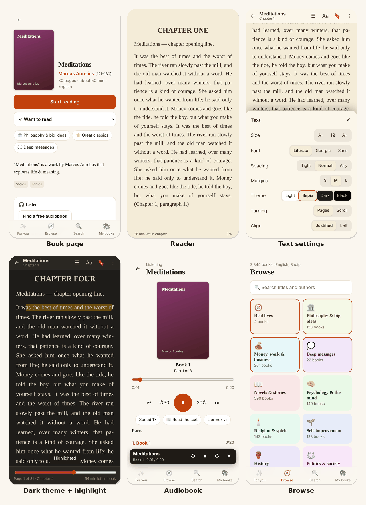

# Readbit

A phone-first reading app for the ~68,000 English, French and German public-domain books on Project Gutenberg. It recommends books, has a full e-reader, plays free LibriVox audiobooks, keeps books on the phone for offline reading, and syncs your shelves and reading position between devices.

It runs on Cloudflare's free tier (Workers + D1) and installs on Android or iOS as an app (PWA). There is no framework and no build step: plain JavaScript modules, about 2,600 lines.



<sub>Screenshots use the generated test library from `tests/`, not real books.</sub>

## Features

**Finding books**
- **For you:** recommendations built from the topics, languages and book length you pick, and from what you start, finish, rate 👍/👎 or drop. Results are kept varied (one book per author per row), change a little each day, and "New picks" reshuffles them.
- **Browse:** 28 categories, including *Real lives* (autobiographies, memoirs, letters), *Deep messages* and *Money, work & business*. 30 books per page, sortable by popularity, fit to you, length, title or author era, with filters for length and language.
- Search by title and author, author pages, "More like this", and a short first-run setup that ends with hand-picked starting books.

**Reading**
- **Turning pages:** real pages (CSS multi-column layout) or continuous scroll. Swipe or tap on a phone; on a computer use the mouse wheel, trackpad or arrow keys.
- **Text and themes:** Literata / Georgia / sans fonts, size, spacing, margins, justified or left text, and Light / Sepia / Dark / Black themes.
- **Finding your way:** table of contents, bookmarks, highlights, find in book, and "x min left in chapter / book".
- **Your place is the word you were reading**, stored as a character offset. It survives font changes, rotation and switching devices, not just page numbers.
- **Read aloud** with the device's own voices, which also covers books that have no recording.
- **End of book:** a rating card that feeds back into recommendations.

**Listening, keeping, printing**
- LibriVox audiobooks (human-read, free), with a mini player that keeps playing across screens and lock-screen controls (Media Session API).
- Books you open are stored on the device (IndexedDB) and work offline, as does the app itself (service worker).
- Download the EPUB, or get a print view for paper or "Save as PDF" with your own font size.

**Your data**
- Shelves (Want to read / Reading / Finished / Dropped), positions, highlights, ratings and settings sync between phone and computer. Each change carries a timestamp and the newest one wins.

## How it works

```
Phone / browser (PWA)                        Cloudflare Worker                     Free sources
  app.js       screens & routing   ──/api──▶  sign-in, sessions (D1)
  reader.js    EPUB → pages                   state sync (D1)
  recs.js      recommendations                /api/epub  ── fetch + edge cache ──▶  Project Gutenberg
  store.js     sync + offline books           /api/audio ── lookup + cache ──────▶  LibriVox API
  catalog.js   68k-book index (typed arrays)  static files (Workers assets)
```

- **Catalog pipeline** (`setup/build-catalog.mjs`): it streams Gutenberg's ~100 MB `rdf-files.tar.bz2` and reads the tar with its own small reader (GNU long names and pax headers included). It parses about 75,000 RDF records, keeps the text books in the chosen languages, and sorts each into categories using rules over Library of Congress subjects and classes plus Gutenberg bookshelves (stored as a bitmask). Page counts are estimated from file sizes. The output is a compact `books.json` (7 MB, 2.9 MB gzipped) that the phone loads once, and 400 small summary files fetched on demand. It refreshes monthly on deploy.
- **Recommendations** run on the device. Every book is scored once per screen: topic affinity, an author bonus or penalty learned from your shelves and ratings, length fit, and popularity, plus a small daily random factor. Rows are then filled with a one-book-per-author rule. There is no tracking and no server-side profile.
- **Reader:** the EPUB is unzipped in the browser (JSZip). It reads the OPF spine and the EPUB 3 nav or NCX table of contents, and removes scripts, styles, event handlers and Gutenberg's licence boilerplate. Pages are laid out with CSS columns and moved with `scrollLeft`. Images are loaded before measuring, and the page count is re-measured if one arrives late.
- **Sign-in:** a single passphrase, stored only as a salted PBKDF2-SHA256 hash in a Worker secret, with an 8-tries-per-15-minutes limit per IP. The session cookie is `HttpOnly; Secure; SameSite=Lax`, and cross-origin POSTs are rejected. The EPUB proxy only accepts numeric book IDs, so it can't be used as an open proxy.

**Tech:** Cloudflare Workers, D1 (SQLite), Workers static assets, Cache API · vanilla JavaScript (ES modules), CSS multi-column layout, IndexedDB, Service Worker, Web Speech API, Media Session API, Web Crypto · JSZip · Node.js build tooling · Playwright (Python) end-to-end tests.

## Run your own

You need a free Cloudflare account and Node.js 20+.

```bash
npm install
npm run deploy        # Windows: double-click deploy.bat
```

On the first run the script logs you in to Cloudflare, creates the D1 database and tables, builds the catalog (a few minutes), publishes the Worker and asks you to choose a passphrase. Running it again publishes updates.
- `npm run deploy -- refresh` downloads a fresh catalog now.
- `npm run deploy -- passphrase` sets a new passphrase.

On the phone, open the printed link in Chrome, then choose ⋮ → **Install app**.

## Tests

```bash
pip install playwright && playwright install chromium
npm test
```

`tests/run.sh` builds a throwaway copy of the app with a generated test library. It starts a fake Gutenberg + LibriVox server (generated EPUBs with covers, images, links and licence sections, plus WAV audio) and runs the app locally with `wrangler dev`. It then drives headless Chromium through 66 checks across 4 suites:
- **Flow:** sign-in, setup, recommendations, browse, filters and paging, search, book page, reader, bookmarks, highlights, find, audio, offline copies, sync to a second device, and the print view.
- **Regressions:** bugs found in QA, such as unreachable last pages in chapters with images, position drift on font change or rotation, read-aloud failure, and the Android back button.
- **Touch:** swipes and taps on a phone-sized screen.
- **Desktop:** mouse-wheel and trackpad paging.

## Project layout

| Path | What |
|---|---|
| `src/worker.js` | API: sign-in, sessions, sync, EPUB proxy, LibriVox lookup |
| `public/app.js` | Screens and routing |
| `public/reader.js` | EPUB parsing, reader, read aloud, print view |
| `public/recs.js` | Recommendations |
| `public/catalog.js` · `cats.js` | Catalog loading, search · category list |
| `public/store.js` | Local state, sync, offline books |
| `public/player.js` | Audiobook player |
| `public/sw.js` | Offline support |
| `setup/build-catalog.mjs` | Gutenberg catalog → `public/catalog/` |
| `setup/setup.mjs`, `deploy.bat` | One-click setup and deploy |
| `schema.sql` | D1 tables |
| `tests/` | Fake services, test library generator, Playwright suites |

## Credits

- Books: [Project Gutenberg](https://www.gutenberg.org). Audiobooks: [LibriVox](https://librivox.org). Both are volunteer projects; please consider supporting them. Readbit fetches a book only when someone opens it and caches it at the edge.
- [JSZip](https://stuk.github.io/jszip/) (MIT), bundled in `public/lib/`. [Literata](https://fonts.google.com/specimen/Literata) font (OFL) via Google Fonts.

## License

[MIT](LICENSE)
